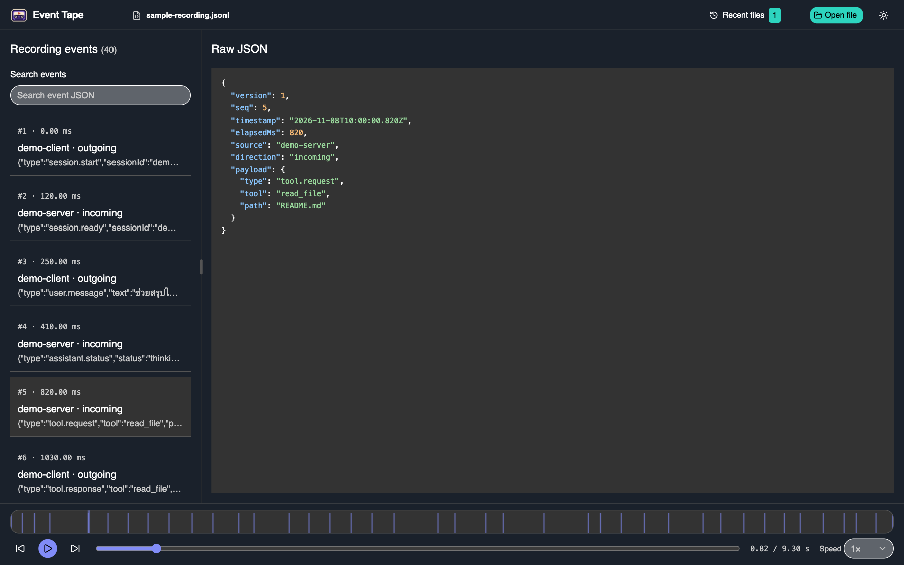

# Event Tape

<p align="center">
  
</p>

Record application events and inspect them later on a timeline. Event Tape pairs a headless SDK for writing recordings with a local Player for exploring event sequences, timing, and payloads.



## What you can do

- Record events from your application's own listeners to a JSONL file.
- Open recordings locally, search their events, and inspect their raw JSON.
- Navigate the timeline, select a playback range, and control playback speed.

Playback is **view-only**: it does not send events back to an application. Replay through an application or protocol adapter is not supported.

## Requirements

- Node.js >=22.12.0 for the Player CLI (the Recorder SDK runtime requirement remains unchanged)
- pnpm 11.9.0 (Corepack can provide the pinned version)

## Quick start

Clone this repository, install its dependencies, and open the included 40-event sample recording:

```sh
pnpm install
pnpm view:sample
```

The shortcut builds the Player and opens the sample in your browser. The Player runs locally.

In the Player, search filters the event list without changing playback or the inspected event. Select an event to pause playback and move the playhead to it. Focus an event row and use ↑ or ↓ to select the previous or next visible event; navigation stops at the ends of the list. Arrow keys in the search field remain available for editing. Drag on the timeline to select an inclusive playback range.

The Player keeps file controls in a compact header, with independently scrolling event and JSON panes above a full-width playback controls. Drag the divider or use its arrow keys to resize the panes; on narrow screens the panes stack.

## Use Event Tape in your project

The packages are installed from this checkout; these commands do not publish them to a registry.

### 1. Build and install

From the repository root, build the SDK and Player:

```sh
pnpm --filter @event-tape/sdk build
pnpm --filter @event-tape/player build
```

From your application project, install the SDK using the path to this checkout:

```sh
npm install /path/to/event-tape/packages/sdk
```

Install the Player CLI globally from the checkout:

```sh
npm install --global /path/to/event-tape/apps/player
```

### 2. Record events

Connect the SDK to an application-owned listener. The SDK does not install listeners or interpret protocol messages. Filter secrets before recording, and await `close()` before exiting.

```js
import { createRecorder } from '@event-tape/sdk'

const recorder = createRecorder({ file: './recordings/session.jsonl' })
const onMessage = (message) => {
  recorder.record({
    source: 'my-app',
    direction: 'incoming',
    payload: message,
  })
}

myListener.on('message', onMessage)
try {
  await runApplication()
} finally {
  myListener.off('message', onMessage)
  await recorder.close()
}
```

### 3. Open a recording

```sh
event-tape view ./recordings/session.jsonl
```

Alternatively, run the built CLI directly from the checkout:

```sh
node apps/player/dist/cli.mjs view ./path/to/recording.jsonl
```

## Recording format and recovery

The Player opens Event Tape recording envelope format version 1 and parses it in a Web Worker. A complete final JSONL record is accepted with or without a terminating newline.

If the last line is invalid JSON and has no terminating newline, the Player keeps the complete preceding records and displays a recovery warning. If there are no preceding records, it shows an empty recording with the warning. This is best-effort recovery of a likely crash-truncated tail, not proof that the recording is complete: events still buffered in the recorder may never have reached disk.

Invalid JSON in a terminated or interior line, invalid envelopes, and unsupported versions reject the recording with a line number and cause; the Player does not skip damaged records. Empty recordings have no events to inspect.

## Development

Run these commands from the repository root:

```sh
pnpm install
pnpm --filter @event-tape/player dev
pnpm typecheck
pnpm lint
pnpm test
pnpm build
```
